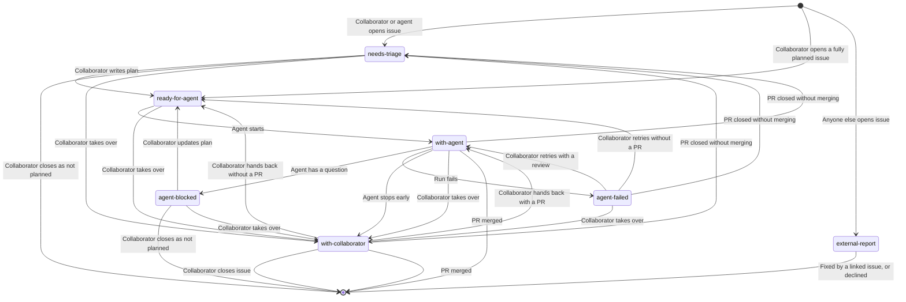

# Scratch: Middle Ground

Temporary comparison file. Option 2: one issue state machine, plus a table of
the PR events the workflow reacts to.

## Issue State Machine

Each state is one status label on the issue. Transitions marked "PR merged" and
"PR closed without merging" are caused by [PR events](#pr-events).

## PR Events

A PR's own state is GitHub's (open, CI status, reviews, merged, closed), with no
labels. The workflow reacts to these events on a PR from an issue branch:

| PR Event                                           | Reaction                                                   |
| -------------------------------------------------- | ---------------------------------------------------------- |
| Agent opens the PR                                 | Agent waits for CI and fixes failures                      |
| Collaborator submits a review that is not approval | Review run, if the issue is `with-agent` or `agent-failed` |
| Collaborator approves                              | Nothing                                                    |
| Collaborator merges                                | Issue closes, branch deleted                               |
| Collaborator closes without merging                | Issue moves to `needs-triage`, branch deleted              |

Rules linking the two:

- An issue has at most one open PR.
- Only an issue that is `with-agent`, `agent-failed`, or `with-collaborator` can
  have an open PR.
- A closed issue has no open PR.
