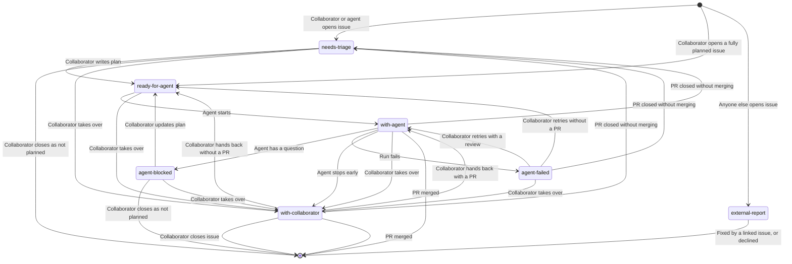
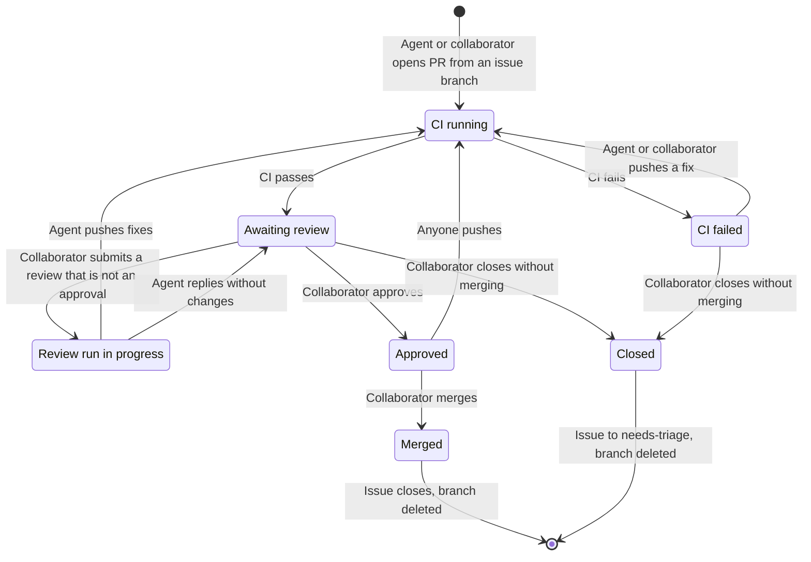

# Scratch: Separate State Machines

Temporary comparison file. Option 1: an issue state machine and a PR state
machine, each with its own diagram.

## Issue State Machine

Each state is one status label on the issue. Transitions marked "PR merged" and
"PR closed without merging" are caused by the
[PR state machine](#pr-state-machine).

## PR State Machine

PR states are GitHub's own, not labels. Each transition is an event that the
workflow reacts to.

Rules linking the two:

- An issue has at most one open PR.
- Only an issue that is `with-agent`, `agent-failed`, or `with-collaborator` can
  have an open PR.
- A closed issue has no open PR.
